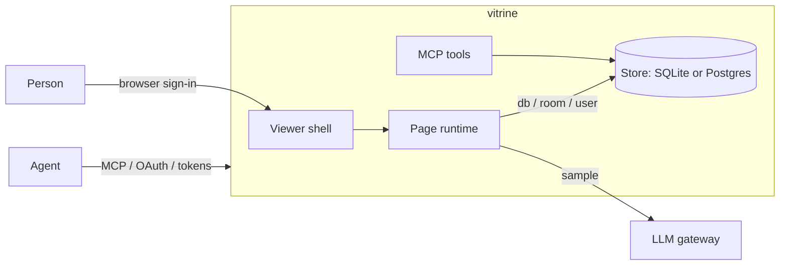

# Feature map

What vitrine does today, and what it does not do yet.

✅ done and covered by tests · 🟡 partly there · ⬜ not built

## Artifacts

| Feature | State | Notes |
|---|---|---|
| Single-file HTML pages | ✅ | scripts and styles only from the CDN allowlist |
| Markdown documents | ✅ | GFM, task lists, footnotes, mermaid; sanitized |
| Versions, history, restore | ✅ | every change is a new version, stored gzipped |
| Edit (find/replace) and rewrite | ✅ | `base_version` check refuses stale writes |
| Full-text search | ✅ | FTS5 on SQLite, tsvector on Postgres |
| Import HTML / markdown files | ✅ | `vitrinectl import` |
| Multi-file artifacts | ⬜ | |
| Comments | ⬜ | |
| Version compaction | ⬜ | |

## Agents

| Feature | State | Notes |
|---|---|---|
| MCP server (streamable HTTP) | ✅ | `guide`, `create`, `read`, `edit`, `rewrite`, `list`, `search`, `history`, `restore`, `share`, `declare`, `db_*`, `delete` |
| Same tools over plain HTTP | ✅ | `/api/v1/tools/<name>` |
| OAuth 2.1 for MCP clients | ✅ | dynamic registration, PKCE, rotating refresh tokens |
| Personal API tokens | ✅ | `/settings` or `vitrinectl token` |
| Scoped agent tokens | ⬜ | a token can do everything its user can |
| `sendToClaudeSession` | ⬜ | |

## Viewer

| Feature | State | Notes |
|---|---|---|
| Shell with live reload | ✅ | WebSocket pushes new heads |
| Pinned and fixed versions | ✅ | `/a/<id>/v/<n>`, or a share pinned to a version |
| Raw page and source | ✅ | `/a/<id>/raw`, `/a/<id>/source` |
| Sandboxed frame, CSP | ✅ | opaque origin per frame |
| Page hardening | ✅ | blocks WebRTC, child frames, self-navigation, popups, network hints |
| Reading position for documents | ✅ | |

## Page runtime (`claude.use(...)`)

| Capability | State | Notes |
|---|---|---|
| `db` shared document store | ✅ | queries, `ifVersion`, leases, per-user paths, live snapshots |
| Offline / saved copies | ✅ | `fromCache`, HTTP fallback, polling |
| `room` presence and topics | ✅ | |
| `user` identity | ✅ | |
| `sample` (call a model) | 🟡 | text works with consent; page tools and images are refused |
| `artifact`, `assets`, `mcp` | ⬜ | declaring them warns and they resolve to null |

## Sharing and sign-in

| Feature | State | Notes |
|---|---|---|
| Share levels: view, interact, edit | ✅ | to an email, all users, or public |
| Creator allowlist | ✅ | `VITRINE_CREATORS` |
| Sign-in: exedev, oidc, proxy (headers / secret / JWT), dev | ✅ | refuses unsafe configurations at start |
| Rate limits, trusted proxies | ✅ | |

## Storage and operations

| Feature | State | Notes |
|---|---|---|
| SQLite store | ✅ | |
| Postgres store | ✅ | migrations under an advisory lock |
| Copy between stores | ✅ | `vitrine migrate-store` |
| Backups | ✅ | daily timer on exe.dev, `vitrinectl backup` |
| Several replicas | 🟡 | Postgres store is ready; live updates still go through one process's hub, so run one replica until the event bus lands |

## Tests

| Suite | State | Notes |
|---|---|---|
| Go store tests (SQLite + Postgres) | ✅ | `go test ./...` |
| End-to-end (MCP, OAuth, browsers, auth) | 🟡 | all pass; `browser_test` vote check is flaky, `sample` needs `VITRINE_LLM_URL` |
